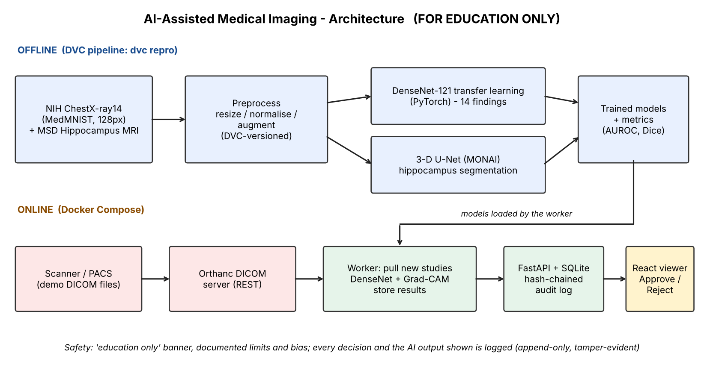
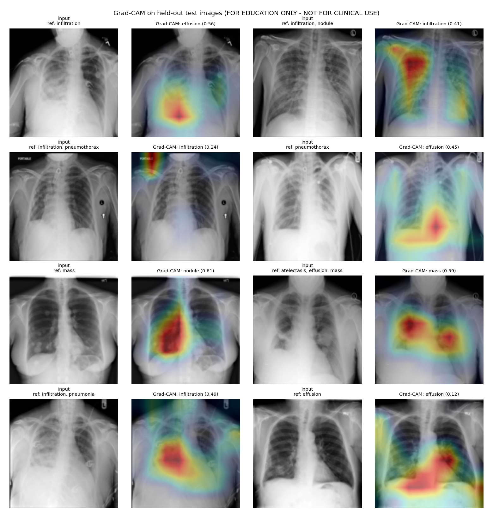

# AIML-02 - AI-Assisted Medical Imaging and Diagnosis System

**GitHub:** https://github.com/Ameya386/AI-Assisted-Medical-Imaging-and-Diagnosis-System

> **FOR EDUCATION ONLY - NOT FOR CLINICAL USE.** This is a learning project, not a medical device.

A small platform where chest X-rays arrive as DICOM, a deep-learning model analyses them, an explanation heat-map
(Grad-CAM) shows where the model looked, and a radiologist reviews the result in a web viewer (Approve / Reject).
Every decision is recorded in a tamper-evident audit log.



## What is in here
| Requirement | Where |
|---|---|
| Public data + DICOM | NIH ChestX-ray14 (via MedMNIST "ChestMNIST") for classification, Medical Segmentation Decathlon *Hippocampus* MRI for segmentation; demo DICOM files built by `src/dicom_utils.py` |
| Preprocess + **DVC** | `src/prepare_data.py`, normalisation/augmentation in `src/preprocess.py` + `src/train_classifier.py`, pipeline in `dvc.yaml` / `params.yaml` |
| Classification (transfer learning) | `src/train_classifier.py` - DenseNet-121 (ImageNet weights), 14 findings |
| Segmentation (3D U-Net, MONAI) | `src/train_segmentation.py` |
| **Grad-CAM** | `src/gradcam.py` (from scratch) |
| **Orthanc** DICOM server + service | `configs/orthanc.json`, `service/worker.py` (pulls new studies, runs inference, stores results) |
| **React** viewer + audit log | `frontend/index.html`, `service/api.py`, `service/store.py` |
| **Docker** | `Dockerfile`, `docker-compose.yml` |
| Limits and bias, "education only" notice | `docs/MODEL_CARD.md`, banner in the viewer |

## Results (held-out test data)
| Model | Metric | Result |
|---|---|---|
| DenseNet-121 classifier (14 chest findings, 20k training images, 128 px) | mean AUROC | **0.799** (best: cardiomegaly 0.898, effusion 0.870; weakest: infiltration 0.680) |
| 3-D U-Net, hippocampus MRI (182 training volumes) | Dice (anterior / posterior / mean) | **0.881 / 0.867 / 0.874** |

DICOM service: 12 demo studies ingested from Orthanc and analysed; audit log of 14 entries verified (hash chain valid).



Full write-up: **[docs/PROJECT_REPORT.md](docs/PROJECT_REPORT.md)** - Model limits and bias: **[docs/MODEL_CARD.md](docs/MODEL_CARD.md)** - Reflection: [docs/REFLECTION.md](docs/REFLECTION.md)

Verified: training/evaluation, Orthanc + worker + API + React viewer (on Colab). Written but not run: the Docker Compose stack.

## Run it
```bash
pip install -r requirements.txt
dvc repro                        # needs a git repo (.dvc/ is already set up); or: python run_all.py   (GPU recommended - see notebooks/run_on_colab.ipynb)

# Option A - everything in Docker (Orthanc + API + worker + React viewer)
docker compose up --build
python scripts/upload_to_orthanc.py --dir samples/dicom --url http://localhost:8042
# open http://localhost:8000

# Option B - without Docker/Orthanc
python -m service.worker --dicom-dir samples/dicom --once
uvicorn service.api:app --port 8000      # open http://localhost:8000
```
The React viewer is a single `index.html` (React 18 + Babel loaded from a CDN) so no Node build step is needed.
