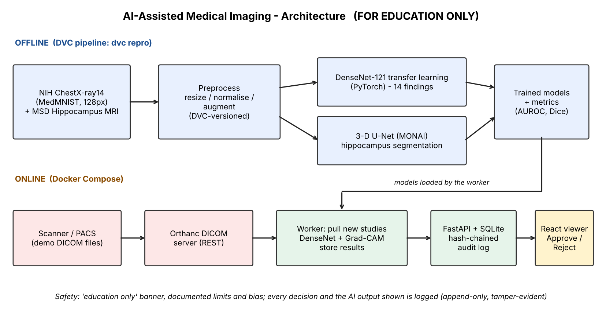
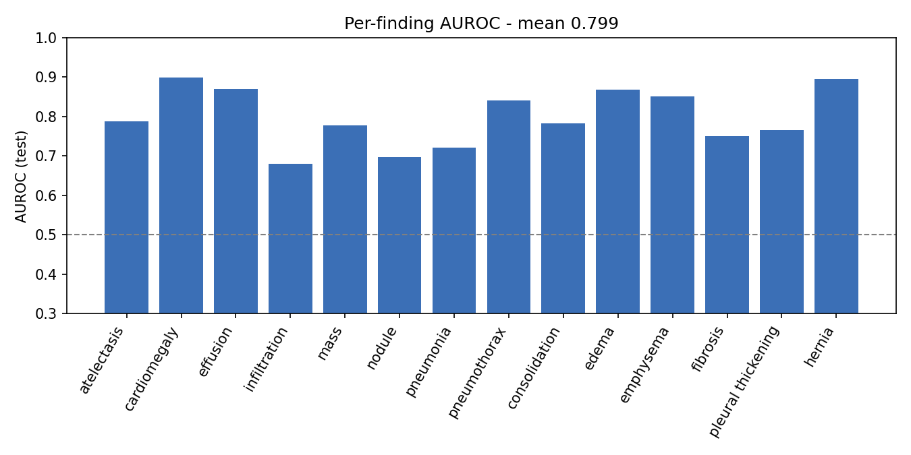
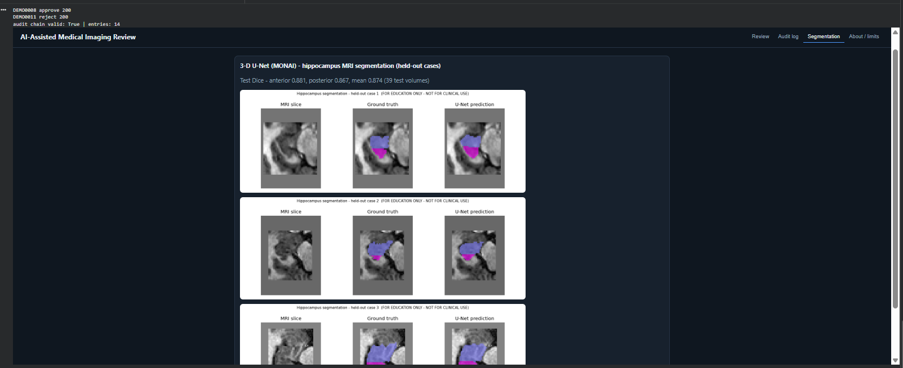
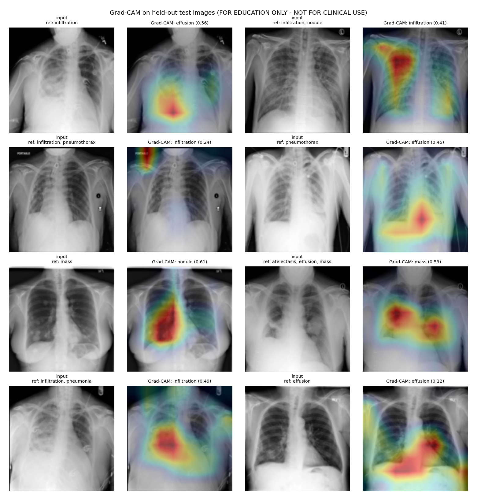
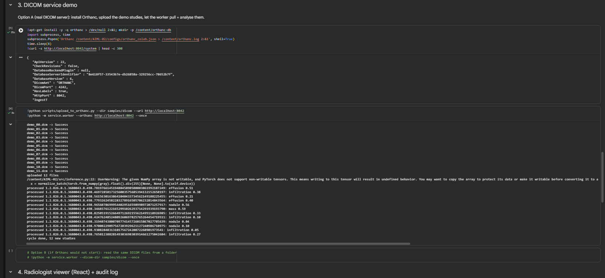
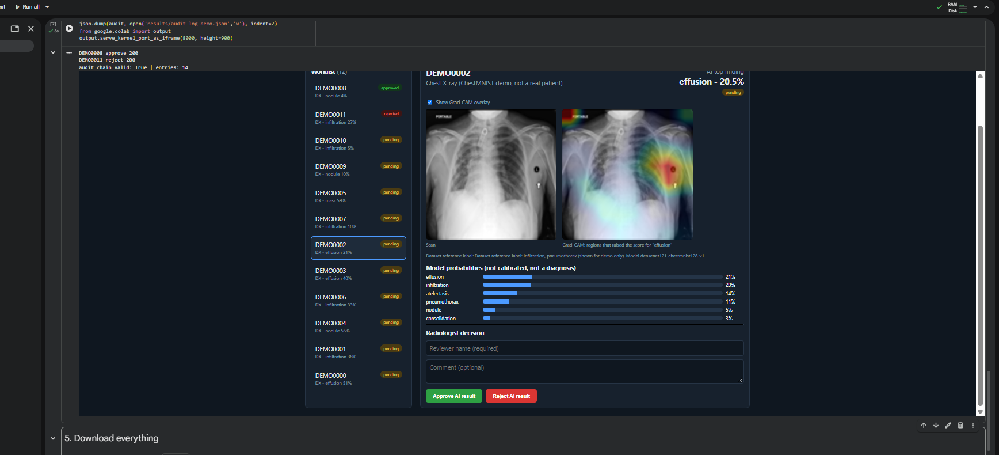
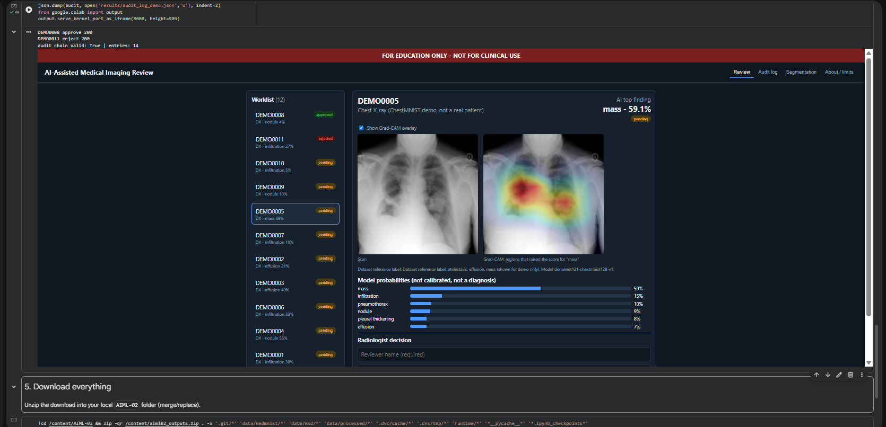
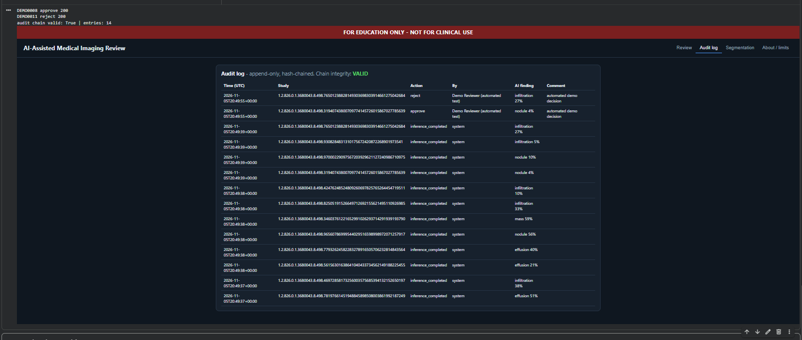

# AIML-02 - AI-Assisted Medical Imaging and Diagnosis System
**Intern:** Ameya Kamble | **Track:** AI / Machine Learning

> **FOR EDUCATION ONLY - NOT FOR CLINICAL USE.**

This report replaces a recorded walkthrough: it explains what was built, shows real outputs, and states what was and
was not verified.

## 1. What it does
Chest X-rays arrive as DICOM files in an Orthanc DICOM server. A service pulls each new study, runs a deep-learning
classifier, produces a Grad-CAM heatmap showing where the model looked, and stores the result. A radiologist then reviews
it in a React web viewer, sees the scan, the AI overlay and a confidence score, and clicks **Approve** or **Reject**.
Every decision is written to a tamper-evident audit log. A second model segments the hippocampus on MRI.



## 2. Requirement map
| # | Requirement | What I did | Where |
|---|---|---|---|
| 1 | Public data, learn DICOM | NIH ChestX-ray14 via MedMNIST (ChestMNIST, 128 px) and MSD Hippocampus MRI. Demo DICOM studies are generated from held-out test images with full patient/study/series headers | `src/prepare_data.py`, `src/dicom_utils.py`, `samples/dicom/` |
| 2 | Preprocess, DVC | ImageNet normalisation, GPU augmentation (rotation, scale, shift, brightness/contrast; no flips, as left/right matters). Pipeline defined in `dvc.yaml`, parameters in `params.yaml`, hashes recorded in `dvc.lock` | `src/preprocess.py`, `src/train_classifier.py`, `dvc.yaml` |
| 3 | Classifier + 3D U-Net | DenseNet-121 transfer learning (14 findings); 3-D U-Net in MONAI (hippocampus) | `src/train_classifier.py`, `src/train_segmentation.py` |
| 4 | Grad-CAM | Written from scratch with PyTorch hooks | `src/gradcam.py` |
| 5 | Orthanc + service | Orthanc runs, the worker polls `/changes`, downloads each new instance, runs inference, stores results (SQLite) and writes a summary back to the Orthanc instance as metadata | `service/worker.py`, `configs/orthanc.json` |
| 6 | React viewer | Scan, AI overlay toggle, probability bars, confidence, Approve/Reject, reviewer name + comment, audit log tab | `frontend/index.html`, `service/api.py` |
| 7 | Docker, limits, notice | Dockerfile + Compose for Orthanc/API/worker; "education only" banner on every page; limits and bias in the model card | `Dockerfile`, `docker-compose.yml`, `docs/MODEL_CARD.md` |

## 3. Data and preprocessing
* Classification: 20,000 train / 4,000 validation / 10,000 test images (sub-sampled from ChestMNIST using the dataset's split).
  About 54% show no finding; rare findings such as hernia are about 0.2% of images.
* Segmentation: 260 labelled hippocampus MRI volumes split 182 / 39 / 39 (train / validation / test).
* DVC tracks the prepared data (about 432 MB, cached locally, git-ignored) and records hashes of the models and results in
  `dvc.lock`, so `dvc repro` rebuilds the exact pipeline. No DVC remote is configured, so the cached data is not stored in GitHub.

## 4. Results (held-out test data)
**Classifier** - mean AUROC **0.799** over 14 findings (10,000 test images; validation 0.801).

| Finding | AUROC | Finding | AUROC |
|:--|--:|:--|--:|
| cardiomegaly | 0.898 | consolidation | 0.783 |
| hernia | 0.896 | atelectasis | 0.788 |
| effusion | 0.870 | mass | 0.778 |
| edema | 0.869 | pleural thickening | 0.766 |
| emphysema | 0.851 | fibrosis | 0.751 |
| pneumothorax | 0.841 | pneumonia | 0.722 |
| nodule | 0.697 | infiltration | 0.680 |



**Segmentation** - 3-D U-Net, test Dice: anterior **0.881**, posterior **0.867**, mean **0.874** (39 volumes).



## 5. Explanations (Grad-CAM)


In the 8 abnormal test images shown, the top predicted finding matched one of the dataset's reference labels in 5 cases
(a small, un-curated sample, not a performance estimate). Where the heatmap lands on the lungs it helps a reviewer; in other
cases it highlights a corner text label or a small chest marker. That is a real shortcut-learning risk and is documented in
the model card.

## 6. DICOM service and viewer (real run on Colab)
Twelve demo DICOM studies were uploaded to Orthanc; the worker pulled and analysed all 12 (`12 new studies`).



Radiologist view: scan, Grad-CAM overlay, probabilities, decision form.




## 7. Audit log
The audit table is append-only (SQLite triggers refuse UPDATE/DELETE) and **hash-chained**: each row stores
SHA-256(previous hash + the row), so editing any row breaks verification (`/api/audit` reports `chain_valid`). Unit tests
in `tests/test_store.py` cover the decision flow, validation and tamper detection. The run recorded 14 entries (12
AI results and two demo decisions, made by the notebook under the name "Demo Reviewer (automated test)", not by a real
clinician); the chain verified as valid (`results/audit_log_demo.json`).



## 8. What was and was not verified
| Item | Status |
|---|---|
| Training, evaluation, Grad-CAM, segmentation | Run on a Colab T4; numbers above are from that run |
| Orthanc + worker + API + React viewer | Run on Colab (Orthanc installed with apt, viewer opened inline); all four tabs checked |
| Audit log tamper detection | Unit-tested and chain verified in the run |
| Docker / Docker Compose | **Written but not run** - I did not run the containers in this project |
| DVC | Pipeline run with `dvc repro` on Colab; no remote storage configured |
| Triton / other servers | Not part of this project |

## 9. Limits and bias
See `MODEL_CARD.md`: low resolution (128 px), noisy text-mined labels, single-institution data without external
validation, uncalibrated probabilities, no subgroup analysis, and shortcut risks. The viewer shows an "education only"
banner on every page and an About tab listing these limits.

## 10. Run it
```bash
pip install -r requirements.txt
dvc repro                        # or: python run_all.py      (GPU recommended; see notebooks/run_on_colab.ipynb)
python -m service.worker --dicom-dir samples/dicom --once      # or --orthanc http://localhost:8042
uvicorn service.api:app --port 8000                           # viewer at http://localhost:8000
# Docker: docker compose up --build ; python scripts/upload_to_orthanc.py --dir samples/dicom --url http://localhost:8042
```

## 11. What went wrong and what I changed
* The first viewer build duplicated the "Dataset reference label" text; fixed in the viewer.
* A NumPy "non-writable array" warning in the worker was removed by copying the image array.
* The model files and results in this repo are exactly those produced by the Colab run; I did not edit any numbers.

## 12. Next steps
Full-resolution data and external validation; calibration and subgroup analysis; patient-level splits; serve the
segmentation model through the same DICOM service; add authentication and a React build step; run the Docker stack end to end.
