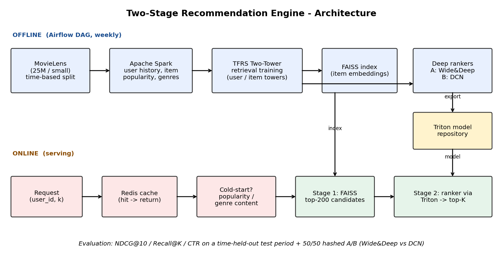

# AIML-03 - Large-Scale Personalized Recommendation Engine
**Intern:** Ameya Kamble  |  **Track:** AI / Machine Learning  |  **Dataset:** MovieLens (ml-latest-small, 100k ratings)

This report replaces a recorded walkthrough: it explains what was built, how to run it, what the results are, and what the limits are.

## 1. What it does
Given a user, it returns the 10 movies they are most likely to like next. It works like the two-stage recommenders used by Netflix or Amazon:
1. **Retrieval** - a fast model narrows ~7,800 movies down to 200 candidates.
2. **Ranking** - a more precise model re-orders those 200 and returns the top 10.
Brand-new users (cold start) get popularity- or genre-based recommendations instead. Results are cached.



## 2. How each required step was done
| # | Requirement | What I did | File |
|---|---|---|---|
| 1 | Dataset, clean, split by time | MovieLens; per-user chronological split: each user's oldest 80% of ratings train, next 10% validation, newest 10% test | `src/data_prep.py` |
| 2 | Spark features | User history stats, item popularity/average rating, genres (Spark script + pandas twin; pandas used for this small run) | `src/spark_features.py`, `src/features.py` |
| 3 | Two-tower retrieval (TF Recommenders) | User tower and item tower (item id + genre), in-batch softmax with popularity correction | `src/train_retrieval.py` |
| 4 | FAISS index | Exact inner-product index over L2-normalised item embeddings | `src/build_index.py` |
| 5 | Deep ranker | Two models for the A/B test: Wide & Deep (A) and DCN (B) | `src/train_ranker.py`, `src/ranker_data.py` |
| 6 | Cold start + Redis cache | Popularity / genre-content fallback; Redis cache (in-memory fallback when Redis is not running) | `src/recommend.py`, `src/cache.py` |
| 7 | Triton, Airflow, A/B test, metrics | Triton model repository exported; weekly retraining DAG; hashed 50/50 A/B replay; NDCG@10, Recall@K, HitRate, CTR | `model_repository/`, `airflow/`, `src/evaluate.py`, `src/ab_test.py` |

## 3. Results
Test set: the newest 10% of each user's ratings, 557 users. A recommendation counts as a hit if the user later rated that movie 4+.

| Model | NDCG@10 | Recall@10 | HitRate@10 | Recall@200 |
|:--|--:|--:|--:|--:|
| Popularity baseline | 0.0502 | 0.0501 | 0.2083 | 0.3407 |
| Two-tower retrieval only | 0.0529 | 0.0696 | 0.2406 | 0.4433 |
| A: Retrieval + Wide&Deep | 0.0599 | 0.0751 | 0.2639 | 0.4433 |
| B: Retrieval + DCN | 0.0661 | 0.0805 | 0.2675 | 0.4433 |

A/B test (offline replay): Wide&Deep CTR 0.032 (269 users) vs DCN CTR 0.042 (288 users), p = 0.136.

**Reading the results**
- The retriever finds 44% of a user's later liked movies within its top 200 candidates, vs 34% for popularity.
- Both rankers improve top-10 quality over retrieval-only; DCN is highest (NDCG@10 0.066 vs 0.053 for retrieval-only).
- DCN beating Wide&Deep is directional only: p = 0.136 is not statistically significant.

## 4. Sample demo run (real output from the trained system)
Existing user, DCN ranker. First call: `cache_hit: False`, 4,877 ms (includes loading the ranker model). Second call: `cache_hit: True`, 0.04 ms.

| # | Title | Score |
|--:|:--|--:|
| 1 | The Godfather (1972) | 0.0604 |
| 2 | American History X (1998) | 0.0588 |
| 3 | Goodfellas (1990) | 0.0580 |
| 4 | Taxi Driver (1976) | 0.0561 |
| 5 | Good Will Hunting (1997) | 0.0559 |
| 6 | Star Wars: Episode VI - Return of the Jedi (1983) | 0.0540 |
| 7 | Star Wars: Episode V - The Empire Strikes Back (1980) | 0.0536 |
| 8 | The Princess Bride (1987) | 0.0533 |
| 9 | Fight Club (1999) | 0.0531 |
| 10 | Star Wars: Episode IV - A New Hope (1977) | 0.0530 |

New user choosing *Comedy + Romance* (strategy: cold-start content-based + popularity; scores here are rank scores, not probabilities): Forrest Gump, Shrek, The Princess Bride, Groundhog Day, Amelie, True Lies, Life Is Beautiful, Shakespeare in Love, Pretty Woman, Four Weddings and a Funeral.

## 5. How to run
```bash
pip install -r requirements.txt        # Python 3.10/3.11, or Google Colab
python run_all.py --dataset small      # data -> features -> train -> index -> rank -> evaluate -> A/B
streamlit run app/streamlit_app.py     # optional interactive demo
```
The `notebooks/run_on_colab.ipynb` notebook runs the same pipeline on Colab. Trained artifacts (`artifacts/`), generated metrics (`results/`) and Triton models (`model_repository/`) are included, so the results can be inspected without re-training.

## 6. Key decisions and what went wrong along the way
- **Split by time, per user.** A single global date cutoff left only 18 users present in both train and test, which made the first evaluation meaningless; per-user chronological splitting fixed that (557 users).
- **Ranker v1 was worse than retrieval-only.** It was trained on random negatives and used user/item ID embeddings, which overfit.
- **Ranker v2 (final).** Trained on the retriever's own candidates (hard negatives), labelled by the validation period, with feature inputs only (user/item stats, genre affinity, retrieval score). This removed the overfitting and the rankers then beat retrieval-only.
- **Triton / Redis / Airflow.** Triton models are exported and the DAG is written, but I did not run Triton or Airflow in this environment. The code falls back to local scoring and an in-memory cache, and the numbers above come from that local path.

## 7. Limitations
- Small dataset (100k ratings, 610 users): results are indicative; differences between the two rankers are within noise.
- The A/B test is a replay on historical data, not live traffic.
- FAISS uses exact search; for millions of items an approximate index (HNSW/IVF) would be used.
- The Spark pipeline is implemented but the reported run used the pandas path; a full 25M-rating run (`--dataset 25m --spark`) was not performed.
