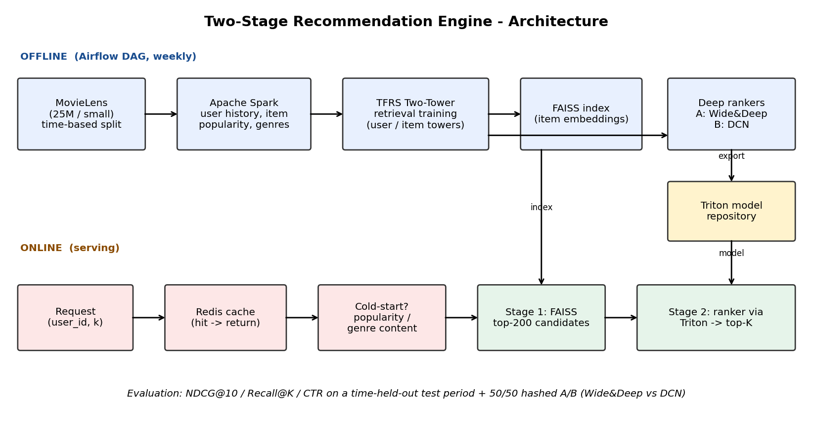
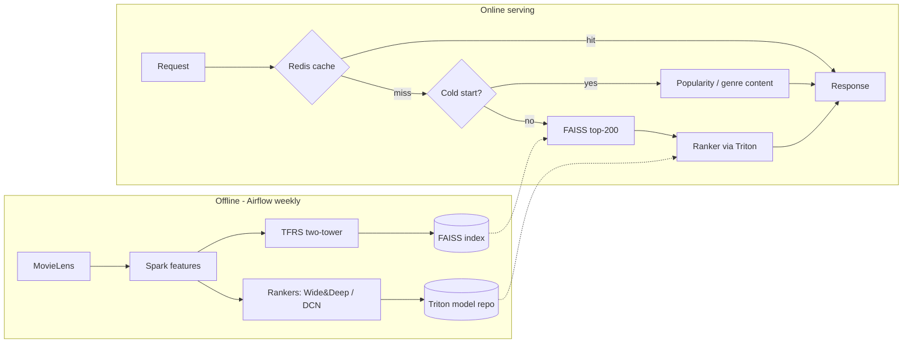

# Architecture

## Design decisions (good to mention in the presentation)
| Decision | Why |
|---|---|
| Split by **time**, not randomly (per user: oldest 80% train / next 10% val / newest 10% test) | Random splits leak the future into training; a global date cutoff left only 18 users in both train and test on MovieLens-small |
| Positive = rating >= 4 | Treat "liked" as the implicit click signal |
| In-batch softmax + log-Q correction | Cheap negatives for 60k items, and corrects popularity bias |
| L2-normalised embeddings + inner product | Makes FAISS inner product == cosine similarity |
| Ranker trained on retrieval's own candidates (hard negatives), labelled by the **validation** period | Matches serving exactly; features come from train, labels from val, so no leakage (an earlier version trained on random negatives and did not beat retrieval-only) |
| Ranker features: user/item stats, user->genre affinity, retrieval score (no ID embeddings) | Gives the second stage information the retriever does not use; ID embeddings overfit on the small validation-period labels |
| Two ranker architectures | Gives a genuine A/B comparison (Wide&Deep vs DCN) |
| Redis with in-memory fallback | Demo never breaks if Redis is not running |
| Triton with local fallback | Same: serving path is production-style, but optional |

## Known limitations (be upfront about these)
* The A/B test is an **offline replay** on the held-out future period, not live traffic.
* FAISS uses exact search (`IndexFlatIP`); for >1M items use HNSW/IVF.
* Few positives per user in the val period (small dataset), so the ranker has limited supervision; the 25M run gives it far more.
* MovieLens has no real "impressions", so CTR here = precision of top-10 against actual later positives.
