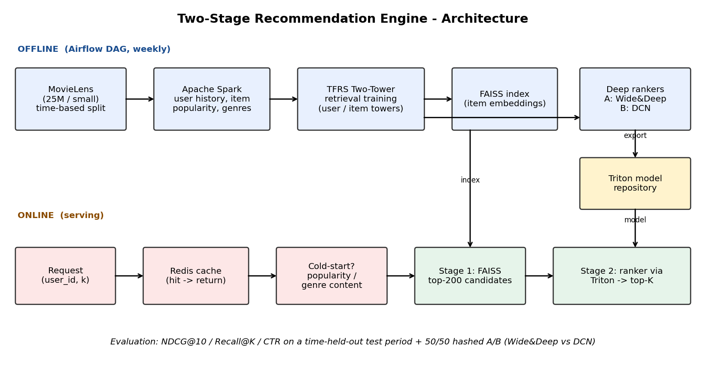
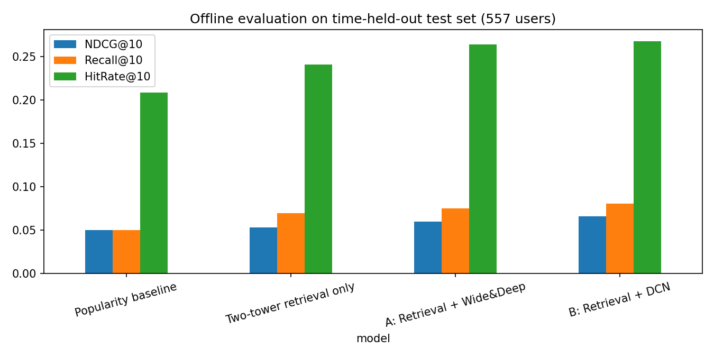

# AIML-03 - Large-Scale Personalized Recommendation Engine

A two-stage recommender in the style of Netflix/Amazon:
**Stage 1** finds a few hundred candidates fast (two-tower model + FAISS), **Stage 2** re-scores them precisely
(deep ranker: Wide&Deep or DCN). Results are cached in Redis, models are servable via Triton, features are built with
Spark and retraining is scheduled with Airflow.



## Quick start
```bash
python -m venv .venv && source .venv/bin/activate      # Python 3.10/3.11 recommended
pip install -r requirements.txt

python run_all.py --dataset small            # ~minutes on CPU: data -> features -> train -> index -> rank -> eval -> A/B
# python run_all.py --dataset 25m --spark    # the full 25M-rating run (use Colab GPU / a decent machine)

streamlit run app/streamlit_app.py           # demo UI
```
No internet? `python run_all.py --synthetic` runs the whole pipeline on generated data (smoke test only).

Optional infra: `docker compose up -d` starts Redis + Triton (`export TRITON_URL=localhost:8000`).
Airflow: set `PROJECT_DIR`, copy `airflow/dags/retrain_recommender.py` into `$AIRFLOW_HOME/dags`, run `airflow standalone`.

## Pipeline -> requirement mapping
| # | Required step | Where |
|---|---|---|
| 1 | MovieLens, clean, **time-based split** | `src/data_prep.py` |
| 2 | Spark interaction tables & features | `src/spark_features.py` (pandas twin: `src/features.py`) |
| 3 | Two-tower retrieval in TF Recommenders | `src/train_retrieval.py` |
| 4 | FAISS nearest-neighbour index | `src/build_index.py` |
| 5 | Deep ranker (DCN / Wide&Deep) | `src/train_ranker.py` |
| 6 | Cold start + Redis cache | `src/recommend.py`, `src/cache.py` |
| 7 | Triton serving, Airflow retraining, A/B test, NDCG / recall@K / CTR | `model_repository/`, `airflow/`, `src/evaluate.py`, `src/ab_test.py` |

## Results
Evaluated on a time-held-out test period (each user's newest 10% of ratings), 557 users, MovieLens ml-latest-small.

| Model | NDCG@10 | Recall@10 | HitRate@10 | Recall@200 |
|:--|--:|--:|--:|--:|
| Popularity baseline | 0.0502 | 0.0501 | 0.2083 | 0.3407 |
| Two-tower retrieval only | 0.0529 | 0.0696 | 0.2406 | 0.4433 |
| A: Retrieval + Wide&Deep | 0.0599 | 0.0751 | 0.2639 | 0.4433 |
| B: Retrieval + DCN | 0.0661 | 0.0805 | 0.2675 | 0.4433 |

**A/B test** (offline replay, users split 50/50 by hash): Wide&Deep CTR 0.032 (269 users) vs DCN CTR 0.042 (288 users), p = 0.136 - directionally better, not statistically significant.



Full explanation, design decisions, a sample demo run and limitations: **[docs/PROJECT_REPORT.md](docs/PROJECT_REPORT.md)**.
Individual reflection: [docs/REFLECTION.md](docs/REFLECTION.md).

## Repo layout
```
src/        pipeline code        app/       Streamlit demo        airflow/dags/   retraining DAG
docs/       project report, architecture, reflection
tests/      metric unit tests    results/   generated metrics     model_repository/  Triton models
```
See `docs/architecture.md` for design decisions and known limitations.
